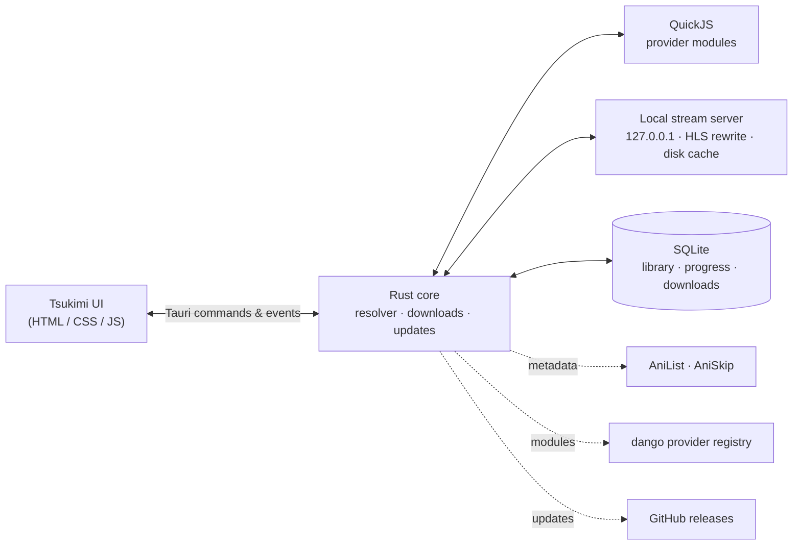

<div align="center">


# Tsukimi

**A fast, native desktop anime player: it finds a working source, starts playback right away and keeps what you
download.**

Tsukimi (月見, "moon-viewing") searches AniList, tests every stream provider in parallel, plays through a local disk
cache, and keeps downloaded episodes until you delete them.

Made by **Akulav**, inspired by [**dango**](https://github.com/serifpersia/dango) by **serifpersia**.<br/>
Anime sources available on the [dango provider registry](https://github.com/serifpersia/dango-providers).


[](https://github.com/Akulav/local-anime/releases/latest)
[](https://github.com/Akulav/local-anime/actions/workflows/ci.yml)

[**Download**](https://github.com/Akulav/local-anime/releases/latest) ·
[Quick start](#-quick-start) ·
[Features](#-features) ·
[Building](#%EF%B8%8F-building-from-source) ·
[Changelog](CHANGELOG.md)

</div>

---

## Contents

- [Why it's different](#-why-its-different) · [Features](#-features)
- [Quick start](#-quick-start) · [What you need](#-what-you-need)
- [Installing, updating and uninstalling](#-installing-updating-and-uninstalling)
- [Downloads](#-downloads) · [Keyboard](#%EF%B8%8F-keyboard) · [How it works](#%EF%B8%8F-how-it-works)
- [Where content comes from](#-where-content-comes-from) · [Settings](#%EF%B8%8F-settings)
- [Building from source](#%EF%B8%8F-building-from-source) · [Versions and releases](#%EF%B8%8F-versions-and-releases) · [Tests](#-tests)
- [Project layout](#%EF%B8%8F-project-layout) · [Troubleshooting](#-troubleshooting) · [Credits and license](#-credits-and-license)

---

## ✨ Why it's different

|  |  |
|---|---|
| 🎯 **Picks the source for you** | Searching already contacts every provider for the top results. Opening a show tests all of them in parallel (find the show, list episodes, **test-play a stream**) and ranks the working ones. |
| 💾 **Downloads that stay** | A downloaded episode lives in its own folder that cache cleanup never touches. It plays from disk with no buffering, even after the provider's links expire, until you delete it. |
| ⚡ **No buffering** | Playback goes through a local streaming cache that downloads the whole episode ahead of the playhead, so seeking is instant. |
| 🔄 **Keeps itself current** | Checks GitHub for a new Tsukimi. One click downloads it, verifies its checksum, installs and restarts. |
| 📦 **One program** | A setup wizard on Windows, an app in a disk image on a Mac, a single file on Linux. No browser tab, no server to run. |

## 🎀 Features

| Area | What it does |
|---|---|
| **Sources** | Every provider from the registry runs in an embedded JavaScript engine. Working sources are ranked by verified playback, episode coverage and latency; switch provider, stream or quality at any time. |
| **Failover** | If a quality, stream or provider fails during playback, Tsukimi moves to the next one and keeps your position. |
| **Streaming cache** | HLS segments download in parallel ahead of the playhead; MP4 sources download progressively and play from the partial file. |
| **Downloads** | Download an episode, a whole show, or press `D` in the player. Downloads run one at a time, pause while you watch something else, survive restarts, fall back to other providers and retry by themselves. |
| **Pre-downloads** | Opening a show caches the episode you'd watch next and the one after it (configurable). Cached episodes are removed 48 h after their last use. |
| **Library** | Continue watching, library, resume position, next-episode prefetch, autoplay, skip intro/outro (AniSkip), subtitles (VTT/SRT/ASS), SUB/DUB. |
| **Caching** | AniList responses (memory + SQLite), provider show IDs and episode lists, playlists, subtitles and cover images, so the app is fast after the first load. |
| **Updates** | Automatic checks (on or off), an **Update** button in the sidebar, SHA-256 verified installs. |

## 🚀 Quick start

1. **Download** the file for your system from the [latest release](https://github.com/Akulav/local-anime/releases/latest)
   and install it (see [below](#-installing-updating-and-uninstalling)).
2. **Search** for a show (`/` or `Ctrl+K`). Sources for the top results are checked while you type.
3. **Open it and press Play.** The Sources panel shows every provider and which one is in use.
4. **Download** episodes you want to keep: the download icon on an episode, **Download all**, or `D` in the player.

> [!TIP]
> Coming from dango? Install Tsukimi over it: the setup removes dango, and Tsukimi moves your library, watch progress,
> settings and downloads over on its first start.

## 🧰 What you need

| | |
|---|---|
| **OS** | Windows 10/11 x64 (with the WebView2 runtime, built into Windows 11 and current Windows 10), a Linux desktop (x86-64, WebKitGTK 4.1: `libwebkit2gtk-4.1-0`, `libgtk-3-0`), or macOS 11+ on Apple Silicon |
| **Disk** | a few GB for the stream cache (limit in Settings), plus whatever you download |
| **Network** | Internet for metadata and streams; downloaded episodes play offline |

## 📦 Installing, updating and uninstalling

| System | File | Where Tsukimi lives | Shortcuts |
|---|---|---|---|
| Windows | `Tsukimi-setup.exe`: a wizard with a license page, a folder you can change and a *desktop shortcut* choice; per user, no administrator rights | `%LOCALAPPDATA%\Programs\Tsukimi` | Start menu, desktop, *Settings → Apps* |
| macOS | `Tsukimi-macos-arm64.dmg`: drag Tsukimi to Applications | Applications | Launchpad, Spotlight |
| Linux | `tsukimi-linux-x64`: `chmod +x` it and run it; it installs itself on its first start | `~/.local/share/tsukimi` | app menu, desktop |

| Your data | Windows | Linux | macOS |
|---|---|---|---|
| Library, progress, settings, logs | `%APPDATA%\akulav\Tsukimi\data` | `~/.local/share/tsukimi` | `~/Library/Application Support/dev.akulav.Tsukimi` |
| Downloads | `%LOCALAPPDATA%\akulav\Tsukimi\data\downloads` | `~/.local/share/tsukimi/downloads` | `…/dev.akulav.Tsukimi/downloads` |
| Stream cache | `%LOCALAPPDATA%\akulav\Tsukimi\cache` | `~/.cache/tsukimi` | `~/Library/Caches/dev.akulav.Tsukimi` |

**Portable mode:** put an empty file named `portable` next to the program; everything then lives in a `data/` folder
beside it. `TSUKIMI_DATA_DIR=<dir>` does the same for any folder.

**Updating.** Tsukimi checks for a new version 20 seconds after it starts and every 6 hours (Settings → Updates can
turn that off), and whenever you press **Check for updates** (Settings or About). When there is one, an **Update**
button appears in the sidebar. Updating downloads the release's file for your system, checks it against the release's
`SHA256SUMS.txt` (a mismatch changes nothing) and then:

- **Windows:** runs `Tsukimi-setup.exe` on your install folder: a progress window, no questions. It removes the old
  version (your data stays), installs the new one and starts it.
- **Linux / macOS:** swaps the program in place (macOS: inside Tsukimi.app, which is re-signed) and starts it again.

A copy you built yourself never replaces itself with a download.

**Uninstalling.**

| System | How |
|---|---|
| Windows | *Settings → Apps → Tsukimi → Uninstall*, or Start menu → *Uninstall Tsukimi*. It asks whether to delete your library and downloads too (default: keep). |
| macOS | Drag Tsukimi from Applications to the Bin; delete the folders above to remove the data. |
| Linux | `~/.local/share/tsukimi/tsukimi --uninstall` (add `--delete-data` to remove the library, downloads and cache too). |

| Option | |
|---|---|
| `--version` | print the version and quit |
| `--here` | Linux: run where the program is instead of installing it |
| `--uninstall` [`--delete-data`] | Linux: remove the program and its menu entries (and the data); macOS: explains what to remove |

## 💾 Downloads

- **Downloaded episodes are permanent.** While an episode downloads, its parts sit in the cache (protected from
  cleanup); once complete it moves to the downloads folder, which the cache size limit, the age limit and *Clear
  everything* never touch. Only deleting it on the Downloads page removes it (a second click confirms).
- **Reliable.** One download at a time, in order; downloads you started go before pre-downloads, pause while the
  player streams something else, and resume after a restart. If the episode's provider fails, the other working
  providers are tried in rank order. A failed download retries by itself after 1, 3, 10 and 30 minutes, 1 and 3 hours,
  and again at every start (or press Retry).
- **Saved playlists.** Each download stores the stream's playlist and subtitles, so it keeps playing from disk after
  the provider's signed links expire.
- **Cached while watching.** Episodes you watch or that were pre-downloaded are cached, shown in their own collapsed
  section, and removed 48 hours after their last use (configurable). The pin button keeps one for good.

## ⌨️ Keyboard

| Key | Action |
| --- | --- |
| `/` or `Ctrl+K` | Focus search |
| `Space` / `K` | Play / pause |
| `←` `→` (`Shift` = 30 s) | Seek 5 s |
| `J` / `L` | Seek 10 s |
| `↑` `↓` | Volume |
| `0`–`9` | Jump to 0–90 % |
| `F` / double-click | Fullscreen |
| `N` / `P` | Next / previous episode |
| `E` | Episode list |
| `C` | Subtitles menu |
| `D` | Download the episode |
| `S` | Skip intro / outro |
| `M` | Mute |
| `Esc` | Close menu → exit fullscreen → close player |

## 🏗️ How it works



- **Probe.** One task per provider, in parallel: resolve the show, list episodes, then fetch the first episode's stream
  to verify it plays. Sources are ranked by state, verified playback, episode coverage, tier, soft subs and latency.
- **Play.** Provider links become local URLs on the stream server, which rewrites playlists so every segment comes
  back through it, downloads segments ahead of the playhead and stores them content-addressed on disk.
- **Download.** A queue resolves the stream like the player does, saves the playlist and subtitles, downloads every
  segment, then moves the finished files to the downloads folder.

## 📡 Where content comes from

Tsukimi doesn't bundle any scrapers and doesn't host any video. Metadata comes from **AniList** (search, details,
episode counts, artwork), with **AniSkip** for intro timestamps. Streams come from the community **provider registry**
([serifpersia/dango-providers](https://github.com/serifpersia/dango-providers)): small JavaScript modules that
Tsukimi downloads, checks against their SHA-256 hash, caches and runs in an embedded JavaScript engine. Providers update
independently of the app. You can point Tsukimi at another registry in *Settings → Providers*.

Provider modules are code from that repository and run with the app's permissions. Only use registries you trust as
much as the app itself.

## ⚙️ Settings

| Group | What you can set |
|---|---|
| **Playback** | SUB / DUB, autoplay next episode, skip intros automatically, mature content, preferred provider |
| **Downloads** | episodes to pre-download; the downloads folder and its size |
| **Buffering & cache** | download the whole episode while playing, parallel segment downloads, prepare the next episode, cache size limit, how long cached episodes stay; clean up / clear the cache |
| **Updates** | automatic checks on or off, **Check for updates**, **Update** with the release notes |
| **Providers** | enable / disable each provider, update them, registry URL, Cloudflare cookie and user-agent |

## 🛠️ Building from source

Requirements: a recent stable Rust toolchain and Node.js (for the Tauri CLI). Windows: the MSVC build tools. Linux:

```bash
sudo apt install libwebkit2gtk-4.1-dev libgtk-3-dev libayatana-appindicator3-dev librsvg2-dev
```

| Command | What it does |
|---|---|
| `cargo run -p tsukimi` | run the app (debug) |
| `cd app && npx @tauri-apps/cli@2 build --no-bundle` | optimized program → `target/release/tsukimi(.exe)` |
| `iscc /DAppVersion=x.y.z /DExe=<path>\tsukimi.exe app\installer\tsukimi.iss` | Windows setup (Inno Setup 6) |
| `powershell -File scripts\installer-images.ps1` | regenerate the setup's pictures after changing the logo |
| `npx @tauri-apps/cli@2 icon app/icons/source.svg -o app/icons` | regenerate the icons (keep 32x32, 128x128, 128x128@2x, icon.png/.ico/.icns) |

## 🏷️ Versions and releases

`[workspace.package].version` in the root `Cargo.toml` is the version. Changes are noted under `[Unreleased]` in
[CHANGELOG.md](CHANGELOG.md), then:

```bash
powershell -File scripts/bump-version.ps1          # patch, or: minor | major | 1.2.3 - turns [Unreleased] into the new version
git commit -am "Release vX.Y.Z: what changed"
powershell -File scripts/release.ps1               # checks everything and pushes main (pushing from GitHub Desktop works too)
```

A push to `main` with a version that has no release yet makes the **Release** workflow run the tests, build Tsukimi on
GitHub's Windows, Linux and macOS runners, create the tag `vX.Y.Z` and publish the release:

| File | |
|---|---|
| `Tsukimi-setup.exe` | Windows setup wizard; also what an update runs |
| `tsukimi-linux-x64` | the Linux program; also what an update downloads |
| `tsukimi-macos-arm64` | the macOS program; what an update downloads |
| `Tsukimi-macos-arm64.dmg` | Tsukimi.app for a first install on a Mac |
| `SHA256SUMS.txt` | checksums of all of the above |

The release notes are the version's section of the changelog. The **CI** workflow checks every push and pull request on
all three systems (format, UI script, clippy without warnings, tests, the setup compiles). The workflow never pushes
commits; pushes that don't change the version publish nothing.

## 🧪 Tests

```bash
cargo test --workspace                                              # unit + offline tests
TSUKIMI_LIVE=1 cargo test -p tsukimi-core --test js_runtime live -- --nocapture   # every provider vs the live sites
cargo run -p tsukimi-core --example e2e -- "frieren"                # search → probe → streams → proxy → disk cache
```

## 🗂️ Project layout

```
crates/tsukimi-core   engine: providers, resolver, stream cache, downloads, updates, metadata, storage
app/                  Tauri shell (binary `tsukimi`) + UI (app/ui, plain HTML/CSS/JS), icons, installer/
app/installer/        tsukimi.iss (Windows setup), Info.plist (macOS app), wizard pictures
scripts/              version bump, release checks, release notes, setup pictures
tools/js-vendor       regenerates the vendored cheerio/Buffer bundle and hls.js
.github/workflows/    ci.yml (checks on 3 systems), release.yml (tests → 3 builds → tag + release)
```

See [CLAUDE.md](CLAUDE.md) for a deeper architecture tour.

## 🩺 Troubleshooting

| Problem | What to do |
|---|---|
| "No working source found" | Switch SUB/DUB, enable more providers in Settings, or press Update next to Providers. |
| A provider needs a cookie | Providers behind Cloudflare (e.g. AnimePahe) need `cf_clearance` and the matching user-agent in Settings → Providers. |
| A download keeps failing | The Downloads page shows the error and when it retries. Retry now with the ↻ button; other providers are tried automatically. |
| Something crashed | `crash.log` and `tsukimi.log` in the data folder (Settings shows its path). |
| macOS: "Tsukimi can't be opened" on first start | Right-click Tsukimi in Applications → *Open* (the app is signed ad hoc, not with a paid Apple certificate). |
| Windows: blank window | Install the [WebView2 runtime](https://developer.microsoft.com/microsoft-edge/webview2/). |

## 📄 Credits and license

- **Made by Akulav**, inspired by [**dango** by serifpersia](https://github.com/serifpersia/dango). Tsukimi is a Rust
  rewrite of serifpersia's original Node.js app and uses the same provider registry and module contract.
- **Anime sources** are available on the [dango provider registry](https://github.com/serifpersia/dango-providers),
  maintained by serifpersia.
- Metadata and artwork from [AniList](https://anilist.co), intro and outro timestamps from [AniSkip](https://aniskip.com).
- Built with [Tauri](https://tauri.app), [rquickjs](https://github.com/DelSkayn/rquickjs), [hls.js](https://github.com/video-dev/hls.js) and [cheerio](https://cheerio.js.org).

The same credits are shown in the app under *About*. Released under the [MIT License](LICENSE), keeping serifpersia's
original copyright notice.

---

<div align="center">


**Made by [Akulav](https://github.com/Akulav)**

</div>
