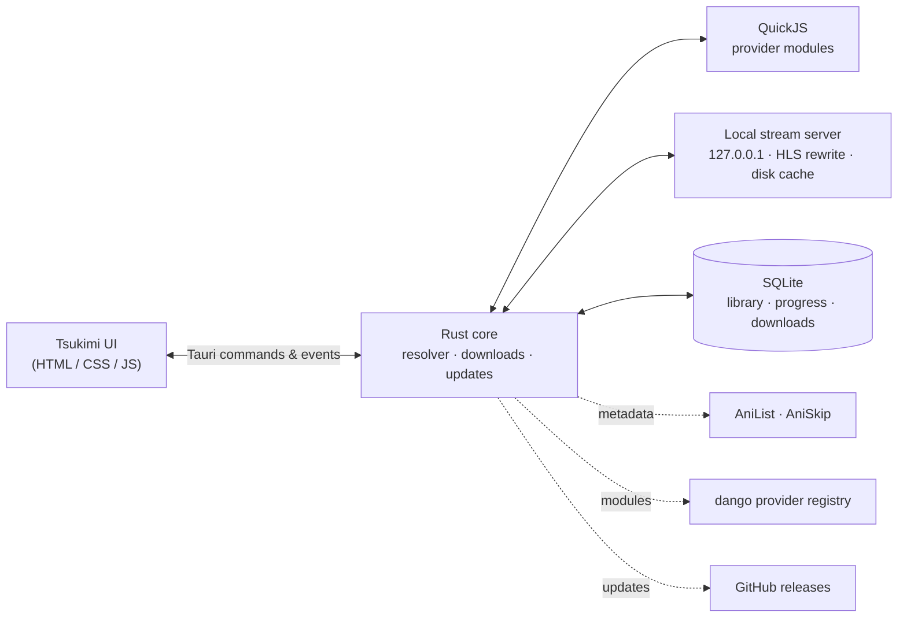

<div align="center">


# Tsukimi

**A fast, native desktop anime player, made by Akulav.**

It finds a working source, starts playback right away and keeps what you download. No telemetry. No bloat. One file per system that installs and updates itself.

Made by **Akulav**, inspired by [**dango**](https://github.com/serifpersia/dango) by **serifpersia**.<br/>
Anime sources available on the [dango provider registry](https://github.com/serifpersia/dango-providers).

[](https://github.com/Akulav/local-anime/releases/latest)
[](https://github.com/Akulav/local-anime/releases)
[](https://github.com/Akulav/local-anime/actions/workflows/release.yml)


### [⬇ Download the latest release](https://github.com/Akulav/local-anime/releases/latest)

</div>

---

## ⬇️ Download

One file per system. The same file installs Tsukimi the first time and updates it later.

| Platform | File | Notes |
| :-- | :-- | :-- |
| 🪟 **Windows 10 / 11** (x64) | [`Tsukimi-setup.exe`](https://github.com/Akulav/local-anime/releases/latest/download/Tsukimi-setup.exe) | Asks where to install. No admin rights needed. Needs WebView2 (built into Windows 11). |
| 🐧 **Linux** (x64) | [`tsukimi-linux-x64`](https://github.com/Akulav/local-anime/releases/latest/download/tsukimi-linux-x64) | WebKitGTK 4.1 (`libwebkit2gtk-4.1-0`, `libgtk-3-0`) |
| 🍎 **macOS** (Apple Silicon) | [`tsukimi-macos-arm64`](https://github.com/Akulav/local-anime/releases/latest/download/tsukimi-macos-arm64) | macOS 11+ |

Every release also ships `SHA256SUMS.txt` so you can verify your download.

## ✨ Features

<table>
<tr>
<td width="50%" valign="top">

### 🎯 Picks the source for you
- Every provider from the registry is tested in parallel: find the show, list episodes, **test-play a stream**.
- Working sources are ranked by verified playback, episode coverage and latency.
- **Failover** during playback: next quality → next stream → next provider, keeping your position.

</td>
<td width="50%" valign="top">

### 💾 Downloads that stay
- Download an episode, a whole show, or press `D` in the player.
- Downloads survive restarts, fall back to other providers, retry by themselves and play from disk after the
  provider's links expire, until you delete them.
- Pre-downloads of the next episodes; cached episodes are cleaned up after 48 h.

</td>
</tr>
<tr>
<td width="50%" valign="top">

### ⚡ Fast & light
- Playback goes through a local streaming cache that downloads ahead of the playhead: instant seeking, no buffering.
- Continue watching, library, resume, autoplay, skip intro/outro, subtitles, SUB/DUB.
- Native Rust + Tauri. No browser tab, no server to run.

</td>
<td width="50%" valign="top">

### 🔄 Always up to date
- **You choose the install folder** once; Tsukimi, your library and your downloads live there.
- **One-click updates** from GitHub, verified with SHA-256, into the same folder.
- Checks 20 s after start and every 6 hours (can be turned off in Settings).

</td>
</tr>
</table>

## 🚀 Getting started

### Windows
1. Download **`Tsukimi-setup.exe`** and run it.
2. Pick the install folder (default `%LOCALAPPDATA%\Programs\Tsukimi`, any folder you can write to works,
   e.g. `D:\Anime\Tsukimi`; your downloads go there too). It adds Start-menu and (optional) Desktop shortcuts and an
   entry in *Settings → Apps*.
3. Updates install into the same folder without asking: in-app with one click, or by running a newer setup.

Uninstall from *Settings → Apps*. The uninstaller asks whether to delete your library and downloads too (default: keep).

### Linux
```bash
chmod +x tsukimi-linux-x64
./tsukimi-linux-x64
```
It asks for an install folder with your system's folder picker (default `~/.local/share/tsukimi`; or pass
`--install-dir <folder>`), copies itself there and adds an app-menu entry. Cancelling runs it from where it is.
Running a newer download later updates the installed copy in its folder. Uninstall with `<folder>/tsukimi --uninstall`.

### macOS (Apple Silicon)
```bash
chmod +x tsukimi-macos-arm64
xattr -d com.apple.quarantine tsukimi-macos-arm64
./tsukimi-macos-arm64
```
It asks for an install folder (default `~/Applications/Tsukimi`) and creates `Tsukimi.app` there.

> 💡 Want it portable? Put an empty file named `portable` next to the program (or set `TSUKIMI_DATA_DIR=<dir>`).

### Watching
1. **Search** for a show (`/` or `Ctrl+K`). Sources for the top results are checked while you type.
2. **Open it and press Play.** The Sources panel shows every provider and which one is in use.
3. **Download** episodes you want to keep: the download icon on an episode, **Download all**, or `D` in the player.

> [!TIP]
> Coming from dango? Install Tsukimi over it: the setup removes dango, and Tsukimi moves your library, watch progress,
> settings and downloads over on its first start.

## 📁 Where your data lives

**In the install folder you chose**, in `data/` next to the program. Install on `D:\Anime\Tsukimi` and your library,
cache and downloaded episodes go to `D:\Anime\Tsukimi\data`; nothing goes to `%APPDATA%`, `~/.local/share` or `~/.cache`.
The folder is remembered (Windows: by the setup; Linux/macOS: in `~/.config/tsukimi/install-dir` or
`~/Library/Application Support/tsukimi/install-dir`), so updates keep everything in place. Data from Tsukimi 4.1 and
older (the OS's per-user folders) and from dango is moved in on the first start, also when the install folder is on
another drive.

| Path | Contents |
| :-- | :-- |
| `data/tsukimi.db` | library, watch progress, settings, download list |
| `data/downloads/` | downloaded episodes (never touched by cache cleanup) |
| `data/cache/` | stream cache (size and age limits in Settings) |
| `data/remote-providers/` | provider modules from the registry |
| `data/webview/` | the window's own browser data (Windows/Linux; macOS keeps it in `~/Library/WebKit`) |
| `data/tsukimi.log`, `data/crash.log` | logs |
| `.tsukimi-install` | marks the install folder (holds the installed version) |

## 🖥️ Command line

| Flag | Meaning |
| :-- | :-- |
| `--version` | Print the version and exit |
| `--here` | Linux / macOS: run where the program is instead of installing it |
| `--install-dir <folder>` | Linux / macOS: install into this folder without asking |
| `--uninstall [--delete-data]` | Linux / macOS: remove the program and its menu entry / app (and the data) |

## ⌨️ Keyboard

| Key | Action | | Key | Action |
| :-- | :-- | :-- | :-- | :-- |
| `/` or `Ctrl+K` | Focus search | | `F` / double-click | Fullscreen |
| `Space` / `K` | Play / pause | | `N` / `P` | Next / previous episode |
| `←` `→` (`Shift` = 30 s) | Seek 5 s | | `E` | Episode list |
| `J` / `L` | Seek 10 s | | `C` | Subtitles menu |
| `↑` `↓` | Volume | | `D` | Download the episode |
| `0`–`9` | Jump to 0–90 % | | `S` | Skip intro / outro |
| `M` | Mute | | `Esc` | Close menu → exit fullscreen → close player |

## 📡 Where content comes from

Tsukimi doesn't bundle any scrapers and doesn't host any video. Metadata comes from **AniList**, with **AniSkip** for
intro timestamps. Streams come from the community **provider registry**
([serifpersia/dango-providers](https://github.com/serifpersia/dango-providers)): small JavaScript modules that Tsukimi
downloads, checks against their SHA-256 hash, caches and runs in an embedded JavaScript engine. Provider modules run
with the app's permissions: only use registries you trust as much as the app itself.

## 🩺 Troubleshooting

| Problem | What to do |
| :-- | :-- |
| "No working source found" | Switch SUB/DUB, enable more providers in Settings, or press Update next to Providers. |
| A provider needs a cookie | Providers behind Cloudflare need `cf_clearance` and the matching user-agent in Settings → Providers. |
| A download keeps failing | The Downloads page shows the error and when it retries; other providers are tried automatically. |
| Something crashed | `crash.log` and `tsukimi.log` in the data folder (Settings shows its path). |
| macOS: "Tsukimi can't be opened" | Right-click Tsukimi → *Open* (the app is signed ad hoc). |
| Windows: blank window | Install the [WebView2 runtime](https://developer.microsoft.com/microsoft-edge/webview2/). |

<details>
<summary><b>🛠️ For maintainers: how it works, updates and releases</b></summary>

### How it works



See [CLAUDE.md](CLAUDE.md) for a deeper architecture tour.

### Publishing a release

1. Note changes under `[Unreleased]` in [CHANGELOG.md](CHANGELOG.md), then
   `powershell -File scripts/bump-version.ps1` (patch, or `minor` | `major` | `1.2.3`).
2. Push to `main`.
3. If no release with that version exists, the **Release** workflow runs the tests, builds all three systems, tags the
   commit `vX.Y.Z` and publishes a GitHub release with exactly three programs, `Tsukimi-setup.exe`,
   `tsukimi-linux-x64` and `tsukimi-macos-arm64`, plus `SHA256SUMS.txt`. The **CI** workflow checks every push and
   pull request on all three systems.

### How updates are applied

An update downloads this system's file, checks it against `SHA256SUMS.txt` (a mismatch changes nothing), then

- **Windows:** runs `Tsukimi-setup.exe` silently on your install folder; it replaces the program and starts it.
- **Linux / macOS:** swaps the program in place (macOS: inside Tsukimi.app, which is re-signed) and starts it again.

A copy built from source never replaces itself with a download.

### Building from source

Requirements: a recent stable Rust toolchain and Node.js (for the Tauri CLI). Windows: the MSVC build tools. Linux:
`sudo apt install libwebkit2gtk-4.1-dev libgtk-3-dev libayatana-appindicator3-dev librsvg2-dev`.

| Command | What it does |
| :-- | :-- |
| `cargo run -p tsukimi` | run the app (debug) |
| `cd app && npx @tauri-apps/cli@2 build --no-bundle` | optimized program → `target/release/tsukimi(.exe)` |
| `iscc /DAppVersion=x.y.z /DExe=<path>\tsukimi.exe app\installer\tsukimi.iss` | Windows setup (Inno Setup 6) |
| `cargo test --workspace` | unit + offline tests |

</details>

## 🙏 Credits

- **Made by Akulav**, inspired by [**dango** by serifpersia](https://github.com/serifpersia/dango). Tsukimi is a Rust
  rewrite of serifpersia's original Node.js app and uses the same provider registry and module contract.
- **Anime sources** are available on the [dango provider registry](https://github.com/serifpersia/dango-providers),
  maintained by serifpersia.
- Metadata and artwork from [AniList](https://anilist.co), intro and outro timestamps from [AniSkip](https://aniskip.com).
- Built with [Tauri](https://tauri.app), [rquickjs](https://github.com/DelSkayn/rquickjs), [hls.js](https://github.com/video-dev/hls.js) and [cheerio](https://cheerio.js.org).

---

<div align="center">

**Made with ❤️ by [Akulav](https://github.com/Akulav)**

<sub>© 2026 Akulav. Source-available under the <a href="LICENSE">Akulav Source-Available License</a>, keeping serifpersia's original MIT notice for dango. Not affiliated with AniList or any provider.</sub>

</div>
